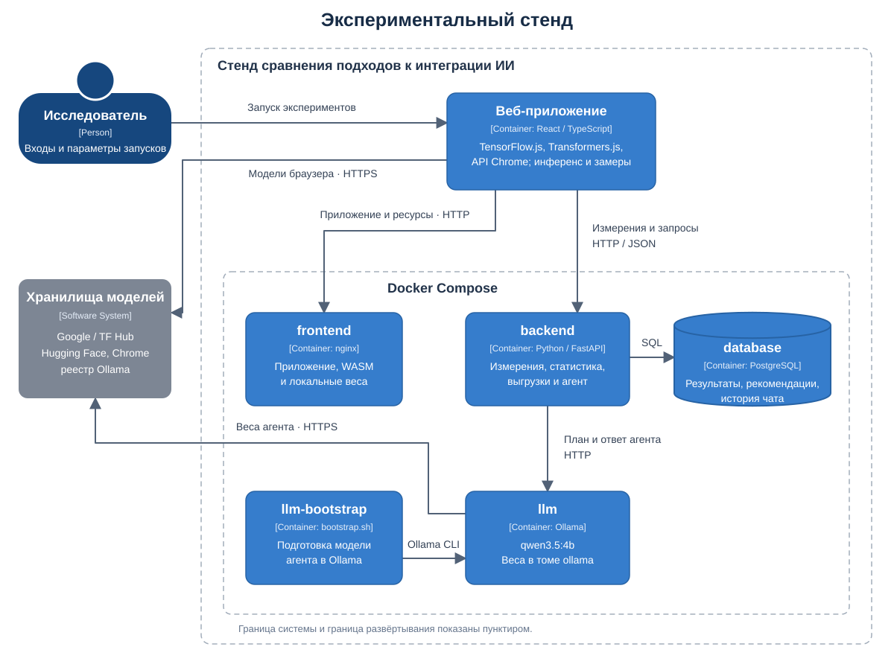
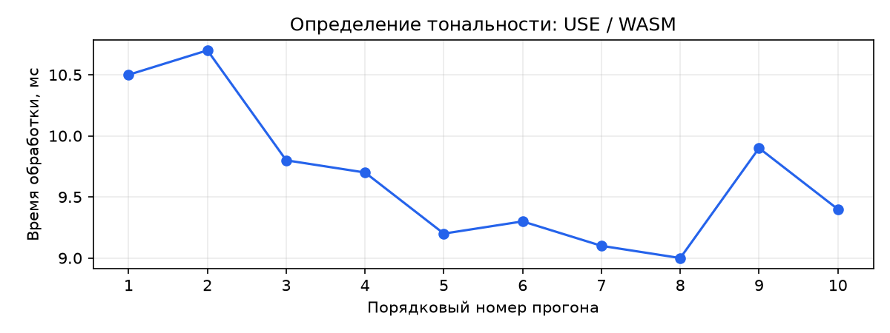
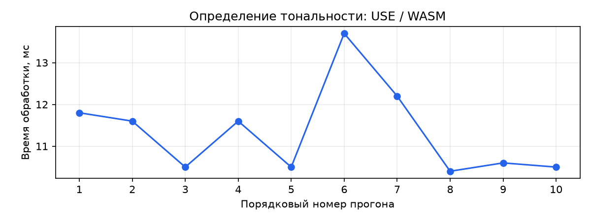
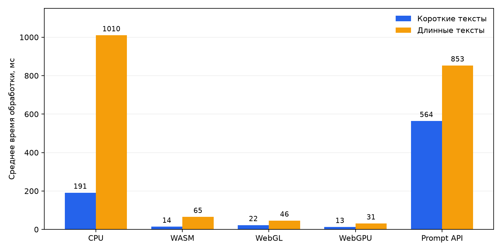

# Лабораторная работа №3-4

## 1. Тема ВКР и краткая постановка задачи

**Тема ВКР:** «Исследование подходов к интеграции искусственного интеллекта в веб-приложения».

**Краткая постановка задачи.** В рамках ВКР необходимо исследовать два подхода к интеграции искусственного интеллекта в веб-приложения - это запуск моделей на стороне клиента с помощью JavaScript-библиотек и использование встроенных ИИ-API браузера. Требуется разработать экспериментальный стенд и сравнить эти подходы на задачах обработки текста и изображений по времени инициализации, времени выполнения, качеству результатов и доступным показателям потребления памяти. По результатам экспериментов предполагается определить условия применимости каждого подхода и сформулировать рекомендации по их выбору при разработке веб-приложений.

## 2. Подборка статей и сводная таблица анализа

### 2.1. Подбор статей (шаг 1)

#### [1] [Moving Deep Learning into Web Browser: How Far Can We Go?](https://doi.org/10.1145/3308558.3313639), 2019 (экспериментальная; рецензируемая - конференция The Web Conference 2019, WWW ’19)

Сравниваются возможности и производительность семи JavaScript-фреймворков, включая TensorFlow.js и TensorFlow на Python. Работа нужна для выбора методики сравнения библиотечных реализаций и оценки накладных расходов браузерного выполнения.

#### [2] [Anatomizing Deep Learning Inference in Web Browsers](https://doi.org/10.1145/3688843), 2025 (экспериментальная; за последние 5 лет; рецензируемая - журнал ACM Transactions on Software Engineering and Methodology, TOSEM; опубликован артефакт)

Исследуется выполнение девяти моделей на 50 компьютерах и 20 мобильных устройствах. Измеряются задержка, потребление памяти и влияние вычислений на пользовательский опыт. Работа нужна для выбора метрик и контролируемых условий стенда.

#### [3] [Empowering In-Browser Deep Learning Inference on Edge Devices with Just-in-Time Kernel Optimizations](https://doi.org/10.1145/3643832.3661892), 2024 (экспериментальная; за последние 5 лет; рецензируемая - конференция ACM MobiSys 2024)

Представлена система nnJIT, которая адаптирует вычислительные ядра к устройству. В экспериментах сравнивается её производительность с существующими решениями на разных устройствах и в разных браузерах. Работа нужна для учёта среды выполнения и затрат на компиляцию.

#### [4] [WPIA: accelerating DNN warm-up in Web browsers by precompiling WebGL programs](https://doi.org/10.1007/s11704-024-40066-w), 2024 (экспериментальная; за последние 5 лет; рецензируемая - журнал Frontiers of Computer Science, Higher Education Press / Springer)

Исследуется ускорение прогрева нейронных сетей за счёт предварительной компиляции WebGL-программ. Эксперименты включают TensorFlow.js и WebDNN. Работа нужна для обоснования раздельного измерения инициализации и последующих запусков модели.

#### [5] [WebLLM: A High-Performance In-Browser LLM Inference Engine](https://arxiv.org/html/2412.15803v1), 2024 (экспериментальная; за последние 5 лет; опубликован артефакт)

Представлен браузерный движок выполнения языковых моделей с использованием WebGPU и WebAssembly. Сравнивается скорость генерации WebLLM и нативного MLC-LLM на одном устройстве. Работа нужна для изучения библиотечного подхода к генеративным задачам и выбора показателей скорости генерации.

#### [6] [CAG: Chunked Augmented Generation for Google Chrome’s Built-in Gemini Nano](https://arxiv.org/pdf/2412.18708), 2024 (экспериментальная; за последние 5 лет; опубликован артефакт)

Рассматривается обработка длинных документов встроенной моделью Gemini Nano с разбиением текста на части. Оцениваются степень сжатия и метрики ROUGE на статьях Wikipedia. Работа нужна для изучения встроенного браузерного подхода и ограничений контекстного окна.

### 2.2. Анализ статей «глазами экспериментатора» (шаг 2)

| Библиографическая ссылка | Исследовательский вопрос / гипотеза | Объект исследования | Независимые переменные (факторы и уровни) | Зависимые переменные (метрики и единицы) | Контролируемые условия | Стенд: архитектура и инструменты | Методика: повторения, прогрев, длительность, порядок | Статистическая обработка | Угрозы, отмеченные авторами | Дополнительная оценка ограничений | Доступность артефактов | Оценка воспроизводимости с обоснованием |
| --- | --- | --- | --- | --- | --- | --- | --- | --- | --- | --- | --- | --- |
| [1] Ma Y., Xiang D., Zheng S. et al. Moving Deep Learning into Web Browser: How Far Can We Go? // The World Wide Web Conference (WWW ’19). 2019. P. 1234-1244. [Электронный ресурс]. URL: [https://arxiv.org/html/1901.09388v2](https://arxiv.org/html/1901.09388v2) (дата обращения: 25.10.2026). | Как возможности и скорость браузерного ML зависят от фреймворка и конфигурации? | Браузерные DL-фреймворки; TensorFlow.js и нативный TensorFlow | Фреймворк; CPU/iGPU/nGPU; в базовом опыте глубина 1/2/4/8, ширина 64/128/256 | Время обучения и инференса, мс; размер модели, МБ; отношение времён | Hasee T97E, Ubuntu 18.04.01, Chrome 71; MNIST; batch=64 | Веб-страницы → расширение Chrome → локальный сервер результатов | Конфигурации задаются URL; загрузка и прогрев рассматриваются отдельно. Число независимых повторений, длительность и рандомизация - не указано | Средние времена, отношения; дерево регрессии sklearn. ДИ и тесты значимости - не указано | Различия поддержки моделей и ограничения браузерного выполнения | Один основной компьютер; версии библиотек описаны как latest; переносимость результатов ограничена | В статье приведены ссылки на используемые библиотеки и MNIST; ссылка на собственный код и исходные результаты экспериментов не приведена | **1** - методика описана; собственные экспериментальные артефакты в статье не представлены |
| [2] Wang Q., Jiang S., Chen Z. et al. Anatomizing Deep Learning Inference in Web Browsers // ACM Transactions on Software Engineering and Methodology. 2025. Vol. 34, no. 2. Art. 47. P. 1-43. [Электронный ресурс]. URL: [https://chenzhenpeng18.github.io/papers/TOSEM25-web.pdf](https://chenzhenpeng18.github.io/papers/TOSEM25-web.pdf) (дата обращения: 25.10.2026). | Как браузерный инференс влияет на производительность и пользовательский опыт? | Девять моделей в TF.js и ORT.js | Wasm/WebGL; модель; устройство; Chrome/Firefox; SIMD и многопоточность включены/выключены | Задержка, мс; память, МБ; Speedometer, запусков/мин; FPS; accuracy/mAP | TF.js 4.2.0, ORT.js 1.14.0; сопоставление на одном устройстве | Веб-сервис и модифицированные профилировщики; 50 ПК, 20 мобильных устройств | Разделены setup/warmup/prediction; повторные измерения. Точное число повторений, длительность и рандомизация - не указано в §3.2 | Средние, дисперсия, распределения. ДИ и тесты значимости - не указано | Выбор моделей, фреймворков и преобразование форматов (§7.1) | WebGPU и встроенные ИИ-API не исследованы | [InBrowserInference](https://github.com/qipengwang/InBrowserInference): исходный код, package-lock.json, yarn.lock, setup.sh и инструкция запуска | **3** - есть код, lock-файлы зависимостей и скрипт подготовки окружения setup.sh |
| [3] Jia F., Jiang S., Cao T. et al. Empowering In-Browser Deep Learning Inference on Edge Devices with Just-in-Time Kernel Optimizations // Proceedings of the 22nd Annual International Conference on Mobile Systems, Applications and Services (MobiSys ’24). 2024. [Электронный ресурс]. URL: [https://www.microsoft.com/en-us/research/uploads/prod/2024/07/mobisys24_nnjit.pdf](https://www.microsoft.com/en-us/research/uploads/prod/2024/07/mobisys24_nnjit.pdf) (дата обращения: 25.10.2026). | Улучшает ли адаптация вычислительных ядер скорость браузерного инференса? | nnJIT и базовые реализации | nnJIT/TF.js/ORT-web/AutoTVM; Wasm/WebGPU; модель; устройство; четыре браузера | Задержка, мс; ускорение, разы; пик JS-кучи, байты | Фиксируется максимальная частота устройств; для сопоставления seq2seq длина входа 384; TF.js 3.21.0, ORT-web 1.14.0 | TVM/Binaryen → генерация ядер → браузер; performance.now(), WebGPU writeTimestamp | Один прогрев, 50 раундов генерации и оценки ядер; это не 50 независимых перезапусков. Рандомизация - не указано | Средняя задержка, относительное ускорение. ДИ и тесты значимости - не указано | Фоновая нагрузка и неоднородность устройств влияют на оценку ядер | 50 раундов адаптации нельзя считать независимыми повторениями | Исходный код nnJIT: [ссылка, приведённая авторами](https://aka.ms/nnjit-web) | **2** - авторы предоставляют ссылку на код; фиксация окружения артефакта в статье не описана |
| [4] Tian D., Ma Y., Han Y. et al. WPIA: accelerating DNN warm-up in Web browsers by precompiling WebGL programs // Frontiers of Computer Science. 2024. Vol. 18, no. 6. Art. 186211. [Электронный ресурс]. URL: [https://journal.hep.com.cn/fcs/EN/10.1007/s11704-024-40066-w](https://journal.hep.com.cn/fcs/EN/10.1007/s11704-024-40066-w) (дата обращения: 25.10.2026). | Сокращает ли предварительная компиляция WebGL-программ прогрев? | WPIA и исходное браузерное выполнение DNN | vanilla/WPIAr/WPIA; шесть моделей; устройство; встроенная/дискретная GPU | Время прогрева, с; сокращение, %; ускорение, разы | Модель и устройство сопоставляются между вариантами; детали версий - не установлено по доступным фрагментам | Сервер предварительной компиляции → браузер с загрузкой бинарных WebGL-программ | Пять повторений; прогрев - измеряемая величина, включает загрузку бинарников для WPIA. Порядок и рандомизация - не указано в доступном фрагменте | Среднее время и относительное сокращение. Разброс, ДИ, тесты - не указано в доступном фрагменте | Не установлено по доступным фрагментам | Зависимость бинарных программ от GPU и драйвера ограничивает переносимость | Опубликованы описание и [дополнительные материалы](https://journal.hep.com.cn/fcs/fileup/2095-2228/SUPPL/20240620140208.pdf); ссылка на код или исходные данные экспериментов не приведена в рассмотренных материалах | **1** - методика описана; исполнимые артефакты и исходные данные не представлены в рассмотренных материалах |
| [5] Ruan C.F., Qin Y., Zhou X. et al. WebLLM: A High-Performance In-Browser LLM Inference Engine // ArXiv. 2024. [Электронный ресурс]. URL: [https://arxiv.org/abs/2412.15803v1](https://arxiv.org/abs/2412.15803v1) (дата обращения: 25.10.2026). | Насколько скорость браузерной генерации близка к нативной? | WebLLM и MLC-LLM | Движок; Llama-3.1-8B/Phi-3.5-mini | Скорость декодирования, токенов/с; доля нативной скорости, % | Один MacBook Pro M3 Max; WebLLM 0.2.75; MLC-LLM d23d6f5; Chrome Canary 133.0.6870.0 arm64 | WebGPU + JS/Wasm против Metal + Python/C++ | Сравнение двух моделей на одном устройстве. Повторения, прогрев, длины входа/выхода, длительность, порядок - не указано в §3 | Таблица скоростей и их отношений. Агрегация повторений, разброс, ДИ, тесты - не указано | Указаны возможности дальнейшей оптимизации WebGPU и runtime | Одно устройство, две модели; статистическая устойчивость не показана | [web-llm](https://github.com/mlc-ai/web-llm): исходный код, примеры запуска и package-lock.json | **3** - есть код, lock-файл зависимостей и примеры запуска |
| [6] Surulimuthu V.V., Rao A.K.G. CAG: Chunked Augmented Generation for Google Chrome’s Built-in Gemini Nano // ArXiv. 2024. [Электронный ресурс]. URL: [https://arxiv.org/abs/2412.18708v1](https://arxiv.org/abs/2412.18708v1) (дата обращения: 25.10.2026). | Позволяет ли разбиение текста обрабатывать документы сверх контекстного окна? | CAG и встроенный Gemini Nano | Длина документа: пять категорий CWQ; тематика | Время, с/статью; сжатие и успешность, %; ROUGE-N/L/S, безразмерные | Wikipedia; базовое окно 6144 токена по статье; точные версии браузера, модели и железо - не указано в §7.1 | cag-js → расширение Chrome → Gemini Nano → инструменты текстовых метрик | Рекурсивное разбиение и суммаризация; число повторений одного документа, прогрев и порядок - не указано | Средние, медианы, диапазоны; отдельные стандартные отклонения. ДИ и тесты значимости - не указано | Основное ограничение - контекстное окно; отдельный систематический разбор угроз - не указано | Неясна независимая эталонная суммаризация для ROUGE; встроенная модель может обновляться | [cag-js](https://github.com/vivekVells/cag-js): исходный код, package-lock.json, .nvmrc и демонстрационное приложение | **3** - есть код, lock-файл зависимостей и файл .nvmrc с версией Node.js |

Шкала воспроизводимости:

- **0** - описания недостаточно даже для повторения идеи;
- **1** - методика описана, артефактов нет;
- **2** - есть код или данные, но окружение не зафиксировано;
- **3** - есть артефакт с зафиксированным окружением (контейнер, lock-файлы, скрипт запуска).

В рассмотренных исследованиях браузерного ИИ чаще всего измеряют время выполнения модели и потребление памяти. Для языковых моделей дополнительно оценивают скорость генерации в токенах в секунду, а для прикладных задач - качество результата. Набор показателей зависит от назначения системы: в WebLLM [5] основное внимание уделено скорости декодирования, в CAG [6] - обработке длинных текстов, степени сжатия и ROUGE. Поэтому сравнение подходов должно начинаться с выбора общей задачи и требований к ответу. По одному показателю скорости нельзя определить, какое решение лучше подходит для веб-приложения.

Заметное место в методиках занимает разделение первого и последующих запусков. Перед первым ответом браузеру может потребоваться загрузить модель, выделить память и скомпилировать вычислительные программы. В исследовании Wang и соавторов [2] эти затраты разделены на подготовку, прогрев и предсказание. Работа WPIA [4] показывает, почему прогрев заслуживает отдельного измерения. Если объединить все этапы, будет трудно понять причину задержки и оценить поведение модели при повторном использовании. Для веб-приложения нужны оба результата: сколько пользователь ждёт при первом обращении и насколько быстро функция работает после подготовки.

Условия выполнения существенно влияют на смысл полученных чисел. Авторы варьируют библиотеки, вычислительные бэкенды, модели и устройства. При этом внутри сравниваемой пары важно сохранять одинаковые входные данные и настройки. Например, в nnJIT [3] для сопоставления ряда моделей фиксируется длина входной последовательности. При измерении генерации также необходимо знать объём ответа: короткий ответ может завершиться быстрее длинного без какого-либо преимущества движка. Отдельной осторожности требует оценка памяти. Показатель JS-кучи, используемый в nnJIT, не охватывает всю память процесса браузера и GPU, поэтому его нельзя напрямую считать полным потреблением ресурсов.

Самая содержательная методика для нашей задачи представлена в работе [2]. Её преимущество - сочетание нескольких видов измерений и широкого набора устройств. Авторы исследуют задержку и память, проверяют влияние инференса на интерфейс, отдельно обсуждают ограничения выбора моделей и фреймворков. Это позволяет оценить работу ИИ в контексте веб-приложения. Методика nnJIT [3] подробнее описывает процедуру оценки: один прогрев и 50 раундов. WPIA [4] полезна более узкой постановкой вопроса и пятью повторениями измерения прогрева.

Наиболее частый недостаток описаний в подборке - нехватка сведений о повторениях и разбросе результатов. Средняя скорость сама по себе не показывает устойчивость преимущества. В WebLLM [5] приведено сравнение двух моделей на одном устройстве, но не раскрыты число повторений и распределение измерений. Такой опыт показывает возможности реализации в конкретных условиях, однако его недостаточно для общего вывода о превосходстве подхода. Другой риск - объяснять разницу только способом интеграции, хотя одновременно меняются модель, ускоритель или параметры обработки. В этом случае сравниваются готовые решения, а вклад каждого фактора остаётся неизвестным.

Проверяемость результатов зависит и от состава опубликованных материалов. Код, lock-файлы и инструкции помогают восстановить программную часть стенда, но для повторения измерений нужны ещё входные данные, настройки и сведения об устройстве. Для встроенных моделей важны версия браузера и дата запуска, поскольку доступная реализация может измениться. Для собственной работы из анализа следует практическое требование: сохранять условия и результаты каждого прогона, отдельно измерять подготовку и выполнение, а скорость рассматривать вместе с качеством ответа. Такой протокол позволит объяснить обнаруженные различия и обозначить условия, в которых рекомендации по выбору подхода остаются применимыми.

## 3. Критерии научности, исследовательский вопрос, гипотезы и переменные

### 3.1. Критерии научности применительно к ВКР

**Объективность и измеримость.** Время подготовки и обработки входа измеряется в миллисекундах через `performance.now()` в браузерных адаптерах. Для каждого замера задаются начало и конец: создание сессии, подготовка модели, получение первого фрагмента или полного ответа. Качество классификации оценивается долей правильных ответов на размеченном наборе, в процентах. Изменение JS-кучи рассчитывается по `usedJSHeapSize` в МиБ. Отдельные результаты сохраняются вместе с параметрами и сведениями о среде, чтобы выводы можно было проверить по исходным данным.

**Контроль переменных.** В сравнении варьируются подход, вычислительный бэкенд и состояние модели. Внутри каждой пары фиксируются устройство, версия браузера, входные тексты, правила оценки и параметры реализации. Холодные и подготовленные запуски анализируются отдельно. Результат могут исказить нагрев устройства, энергосбережение, фоновая нагрузка, кеширование и порядок выполнения. Для уменьшения их влияния предусматриваются одинаковый режим питания, активная вкладка, отсутствие параллельного инференса и случайный порядок сравниваемых серий.

**Повторяемость (repeatability).** Исследователь повторяет независимые серии на том же устройстве, с теми же версиями программ и тестовыми данными. Проверяется, сохраняются ли направление эффекта и согласующиеся значения с учётом разброса. Точное совпадение времени каждого вызова не требуется, поскольку на него влияют планирование браузера и состояние системы.

**Воспроизводимость (reproducibility).** Другой разработчик получает артефакт исследования: код стенда, зафиксированные зависимости, тестовые данные, конфигурацию и порядок запуска. По этим материалам он повторяет измерения и расчёт показателей. Характеристики устройства и доступность встроенных API указываются как условия проверки. При изменении версии встроенной модели различие окружений фиксируется и учитывается при сопоставлении результатов.

**Реплицируемость (replicability).** Другой разработчик создаёт собственную реализацию эксперимента по описанию методики. Для этого описываются подготовка моделей, границы замеров, состав входов, правила оценки и процедура анализа. Проверяется, получает ли независимая реализация согласующееся направление эффекта в сопоставимых условиях.

**Валидность.** В исследовании рассматриваются четыре её вида:

- **Внутренняя.** Различия времени должны объясняться сравниваемыми реализациями, а не порядком запуска или посторонней нагрузкой. Во время измерений исключаются одновременная работа моделей и запросы к агенту Ollama. Порядок серий меняется, влияние кеша и создания сессий учитывается отдельно. Поскольку модели различаются, вывод относится к конкретным решениям задачи, а не к изолированному влиянию интерфейса интеграции.
- **Внешняя.** Выводы связываются с исследованными задачами, устройствами, входами и версиями браузера. Для рекомендаций за пределами этих условий нужны дополнительные проверки. Один текст или одна машина не считаются достаточным основанием для универсального вывода.
- **Конструктная.** Метрика должна соответствовать оцениваемому свойству. Первый фрагмент потока отделяется от полного ответа, правильность классификации - от уверенности модели, JS-куча - от всей памяти процесса и GPU. Создание встроенной сессии и загрузка весов библиотечной модели рассматриваются как разные операции.
- **Статистическая.** Единицей повторения служит независимая серия по тестовому набору. Вызовы внутри одной сессии не подменяют независимые серии. Для эффекта рассчитывается доверительный интервал с учётом парности измерений; при дополнительных сравнениях учитывается их множественность.

**Фальсифицируемость.** До эксперимента задаётся ожидаемое преимущество библиотечной реализации по времени обработки текста. Если она работает столько же или дольше встроенной, результат противоречит ожидаемому направлению эффекта. Если доверительный интервал не позволяет установить преимущество, гипотеза не считается подтверждённой. Ускорение при недопустимой потере качества не удовлетворяет критерию успеха.

### 3.2. Исследовательский вопрос и гипотезы

**Исследовательский вопрос (RQ):** как библиотечный и встроенный браузерный подходы различаются по времени подготовки, времени выполнения и качеству решения одинаковых прикладных задач и при каких условиях каждый из них целесообразно использовать в веб-приложении?

Далее гипотезы, переменные и критерий успеха рассматриваются на примере одного из экспериментов стенда - классификации тональности англоязычного текста (`text_classification`). Этот эксперимент выбран для пояснения методики; исследование охватывает и другие текстовые и визуальные задачи. В текущем проекте библиотечная реализация использует Universal Sentence Encoder и сравнение с опорными векторами позитивной и негативной тональности; встроенная реализация обращается к модели через Prompt API. Обеим реализациям передаётся один текст, результат приводится к двум общим меткам. Это сравнение двух способов решения задачи, а не запуск одной модели через разные интерфейсы.

Основная измеряемая величина - время обработки текста после подготовки модели (`inference_ms`). Для каждой независимой серии рассчитывается медиана времени по одному и тому же тестовому набору. Обозначим через R медиану парных отношений этих значений по независимым сериям: время библиотечной реализации / время встроенной реализации. Пары измерений формируются на одном устройстве и одной версии браузера.

- **H₀:** R ≥ 1. Библиотечная реализация не обеспечивает меньшего времени обработки текста по сравнению со встроенной.
- **H₁:** R < 1. Библиотечная реализация обеспечивает меньшее время обработки текста по сравнению со встроенной.

Ожидаемое направление эффекта - сокращение времени при использовании библиотечной реализации для этой задачи. Гипотеза не распространяется автоматически на суммаризацию, перевод, генерацию или обработку изображений. Эти задачи рассматриваются отдельно, с собственными входами и показателями качества. Эксперимент `tfjs_backends` оценивает влияние ускорителя внутри библиотечного подхода и не служит прямой проверкой H₁.

Для проверки качества потребуется тестовый набор с эталонными метками «позитивная» и «негативная». Состав набора, правила нормализации ответа и обработка неоднозначных случаев фиксируются до основного эксперимента.

### 3.3. Переменные и способы измерения

| Группа | Переменная | Уровни или способ фиксации |
|---|---|---|
| Независимая | Подход и реализация | Библиотечный: USE с опорными векторами; встроенный: Prompt API. Для других задач фиксируется своя пара реализаций |
| Независимая | Вычислительный бэкенд TensorFlow.js | CPU, WASM, WebGL, WebGPU из числа доступных на устройстве. Каждый анализируется отдельно; для встроенного API выбор ускорителя приложением не задаётся |
| Независимая | Прикладная задача | Текстовые и визуальные задачи реестра стенда; в рассматриваемом примере - определение тональности текста. Результаты разных задач не объединяются в одну выборку |
| Независимая | Состояние модели | Первый вызов после сброса состояния страницы; последующие вызовы после подготовки. Загрузка весов из сети и работа с локальным кешем рассматриваются раздельно |
| Зависимая | Время подготовки, `load_ms` | Миллисекунды, разность показаний `performance.now()` в адаптере модели. Включает измеренную загрузку/инициализацию либо создание встроенной сессии |
| Зависимая | Время обработки, `inference_ms` | Миллисекунды от начала обработки входа до готового результата; основной показатель для проверки гипотезы |
| Зависимая | Полное время, `total_ms` | Миллисекунды; сумма `load_ms` и `inference_ms`. Не включает весь путь от нажатия кнопки до сохранения результата на сервере |
| Зависимая | Первый результат, `first_token_ms` | Миллисекунды до первого фрагмента при потоковом ответе. В непотоковых адаптерах это время полного ответа; эти значения анализируются с учётом разных границ замера |
| Зависимая | Качество классификации | Accuracy, %: число верных ответов / число тестовых примеров × 100. Рассчитывается по эталонным меткам, а не по уверенности модели |
| Зависимая | Успешность выполнения | Доли статусов `ok`, `error`, `unsupported`, %. Ошибки и недоступность сохраняются; `unsupported` учитывается как ограничение доступности, а не как время выполнения |
| Зависимая | Изменение JS-кучи, `memory_mb` | Разность `usedJSHeapSize` до и после вызова, делённая на 1024². Это вспомогательная метрика в МиБ, а не полная память модели, процесса или GPU. Отсутствующее значение не заменяется нулём |
| Контролируемая | Входы и ожидаемые ответы | Один версионированный набор для обеих реализаций; одинаковые тексты, язык, метки и правила оценки |
| Контролируемая | Модели и параметры | Версии библиотек и весов, квантование, опорные тексты, промпты, ограничения ответа. Скрытые настройки встроенного API отмечаются как недоступные для управления |
| Контролируемая | Устройство и программная среда | CPU, RAM, GPU, ОС, версия браузера, версия кода; одинаковые условия внутри сравниваемой пары |
| Контролируемая | Условия запуска | Активная вкладка, одинаковый режим питания, отсутствие параллельного инференса и загрузок, заданные повторения и прогрев |

### 3.4. Критерий успеха

В рассматриваемом эксперименте по определению тональности текста преимущество подхода должно выражаться в более быстрой обработке при сопоставимой правильности ответов. Сравнение проводится на одинаковых текстах и одном устройстве. Учитывается время получения полного результата после подготовки модели.

В качестве рабочего критерия предлагается сокращение типичного времени обработки не менее чем на **20 %**. Например, если встроенная реализация обрабатывает текст за 100 мс, библиотечная должна справляться не более чем за 80 мс. Такой порог означает сокращение времени на одну пятую. Он выбран как ориентир для данной работы и не является требованием из рассмотренных статей. Разницу необходимо подтвердить повторными независимыми сериями: единичный быстрый запуск не считается доказательством преимущества.

Допустимую потерю качества предлагается ограничить **2 процентными пунктами**. Например, если встроенная реализация правильно определяет тональность 90 из 100 текстов, библиотечная должна правильно обработать не менее 88. Если она работает быстрее, но ошибается заметно чаще, предложенный критерий успеха не выполняется. Это также выбранное для работы ограничение, а не результат, полученный из статей.

В исследованиях [1]-[4] оценивается время выполнения и влияние условий запуска, а в [2] и [6] рассматривается качество результата. Поэтому в собственной работе скорость и правильность ответа оцениваются вместе. Если ожидаемое преимущество библиотечной реализации не подтвердится, это будет результатом проверки гипотезы. Задача исследования - установить условия выбора подхода, а не обязательно доказать превосходство одного из них.

## 4. Как результаты проверят другие разработчики (Шаг 4)

### 4.1. Что фиксируется и какими инструментами

| Что зафиксировать | Как | Реализация и инструменты в текущем стенде | Альтернативы |
|---|---|---|---|
| Код | Сохранить версию, на которой получены результаты | Git, хеш коммита; исходники фронтенда, бэкенда, адаптеров моделей и агента | Тег релиза, архив выпуска в GitHub/GitLab Releases |
| Зависимости | Зафиксировать точные версии библиотек | `frontend/package-lock.json`, `backend/requirements.txt`. Docker-сборка фронтенда пока выполняет `npm install` без копирования lock-файла | `npm ci` с lock-файлом в сборке; uv.lock, poetry.lock |
| Окружение | Зафиксировать образы, браузер и оборудование | Dockerfile, Docker Compose; версия Chrome, ОС, GPU и доступные бэкенды записываются в `environment`. Для образов дополнительно сохраняются ID/digest | Nix, Dev Containers; образы с фиксированным digest |
| Данные и модели | Сохранить использованные входы, веса и контрольные суммы | Изображения в `frontend/public/samples/`, тексты в реестре экспериментов; загрузчик `scripts/fetch-models.py`, локальные веса в `frontend/public/models/`; SHA-256 через `Get-FileHash` | DVC, lakeFS, Zenodo |
| Конфигурацию эксперимента | Записать задачу, входы, модели, бэкенды, повторения и прогрев | Настройки карточек и поле `settings` результатов; реализации и промпты в `frontend/src/models/`. Число повторений и режим прогрева нужно записать отдельно | YAML/TOML-конфигурация, Hydra |
| Случайность | Сохранить управляемые параметры и порядок запусков | В библиотечной генерации задано `do_sample: false`; порядок оркестратора фиксированный. Общий seed для встроенных API недоступен | Генератор случайного порядка с фиксированным seed и сохранением последовательности |
| Запуск | Передать команды и порядок действий | `docker compose up -d --build`, Makefile, запуск карточек или кнопка «Запустить все» в браузере | Скрипт автоматического эксперимента, Playwright, команда `make experiment` |
| Метаданные прогона | Сохранить, что и в каких условиях выполнялось | PostgreSQL: задача, подход, модель, `settings`, `environment`, метрики, статус, `run_index`, дата. Git-коммит и образы сохраняются отдельно | JSON-манифест опыта, MLflow |
| Независимую проверку | Повторить проверки кода, расчёты и измерения | `backend/tests/`, скрипты `checks/`, API измерений, CSV/JSON-выгрузка. Настроенного CI в проекте нет | GitHub Actions, GitLab CI; повторный запуск на отдельном устройстве |

### 4.2. Сценарий проверки

Проверяющий получает копию проекта той версии, на которой подготовлен отчёт. Команды выполняются в PowerShell из корня проекта. Необходимы Docker Desktop и Chrome с доступными API исследуемых моделей. Ниже показана проверка на примере определения тональности; для остальных экспериментов сохраняется тот же порядок действий.

**1. Запустить стенд и проверить его готовность.**

```powershell
git rev-parse HEAD
docker compose up -d --build
docker compose ps

$apiPort = (docker compose port backend 8000).Trim().Split(':')[-1]
$uiPort = (docker compose port frontend 80).Trim().Split(':')[-1]
$api = "http://localhost:$apiPort"
Invoke-RestMethod "$api/api/health"
Start-Process "http://localhost:$uiPort"
```

Хеш коммита должен совпасть с указанным в отчёте. После готовности сервисов `/api/health` должен вернуть `status: ok` и `database: ok`, а браузер - открыть интерфейс стенда. Загрузки моделей нужно дождаться отдельно.

**2. Проверить программную часть.**

```powershell
docker compose run --rm --no-deps -v ./backend/tests:/srv/tests:ro backend python -m unittest discover -s tests
```

Ожидаемый результат - завершение тестов с сообщением `OK`. Эти тесты проверяют инструменты агента, расчёты, обработку ответов и историю. Качество настоящих браузерных моделей проверяется следующими действиями.

**3. Повторить измерения в браузере.**

Сведения о среде автоматически собираются в начале каждой серии и сохраняются в каждой записи измерения. В карточке эксперимента (на примере определения тональности) проверяющий вводит тот же текст, выбирает бэкенд TensorFlow.js и встроенную реализацию, устанавливает 10 повторений и включает исключение прогревочного вызова. После загрузки моделей запускает карточку, оставляя вкладку активной. До выгрузки результатов другие серии этого эксперимента не запускаются.

Итог проверки - сохранённые измерения, совпадающий пересчёт статистики и вывод о том, согласуется ли повторный эксперимент с данными из предыдущего.

## 5. Проект экспериментального стенда

### 5.1. Архитектура

[](assets/t3-4/architecture-c4-layout.svg)

### 5.2. Спецификация компонентов

В таблице указаны версии из `frontend/package-lock.json`, `backend/requirements.txt` и теги образов из Dockerfile и `docker-compose.yml`. Ссылки на статьи обосновывают назначение компонентов и принципы проведения эксперимента. Выбор конкретных средств интерфейса, API и хранения данных определяется требованиями текущего стенда.

| Компонент | Роль | Технология и версия | Образ контейнера | Обоснование выбора |
| --- | --- | --- | --- | --- |
| Браузерное приложение | Выбор задач, входных данных и параметров; запуск серий и просмотр результатов | React 19.3.0, TypeScript 7.0.2; сборка Vite 8.3.0; Google Chrome, версия сохраняется в измерениях | Работает в браузере пользователя. Сборка выполняется в `node:22.12-alpine` | Аналогично [1], модели запускаются на веб-странице, что позволяет исследовать выполнение непосредственно в браузере. React выбран для общего интерфейса разных экспериментов, TypeScript - для согласования форматов настроек и результатов. |
| Библиотечные реализации моделей | Выполнение задач обработки текста и изображений через JavaScript-библиотеки | TensorFlow.js 4.22.0, бэкенды WASM и WebGPU 4.22.0; Transformers.js 4.3.0 | Отдельного образа нет; библиотеки входят в сборку приложения и выполняются в браузере | TensorFlow.js используется в сравнении браузерных фреймворков [1] и в исследовании прогрева [4], поэтому подходит для проверки влияния вычислительного бэкенда и первого запуска. В отличие от специализированного движка WebLLM [5], выбранный набор библиотек охватывает как генерацию текста, так и классификацию, поиск и обработку изображений. |
| Встроенные ИИ-API браузера | Выполнение тех же прикладных задач средствами Chrome | Prompt API (`LanguageModel`), Summarizer, Writer, Rewriter, Translator, LanguageDetector, Proofreader; доступность зависит от версии и настроек Chrome | Отдельного образа нет; API и модели предоставляет браузер | Аналогично [6], исследуется обращение к встроенной модели через API Chrome. Дополнительные специализированные API позволяют сравнить способы интеграции на нескольких задачах. Их доступность проверяется перед запуском, поскольку одинаковый набор возможностей есть не на всех устройствах. |
| Оркестратор и модуль измерений | Последовательный запуск конфигураций, повторы, исключение первого вызова, сбор времени и сведений о среде | TypeScript 7.0.2; `performance.now()`, `performance.memory` при наличии; модули `runner.ts` и `metrics.ts` | Отдельного образа нет; выполняется внутри браузерного приложения | Аналогично [2], вместе со временем учитываются характеристики среды. Как следует из [4], первый запуск нужно отделять от последующих: компиляция и подготовка модели могут существенно менять задержку. Браузерные таймеры позволяют измерять выполнение без включения времени передачи результатов на сервер. |
| Сервис `frontend` | Раздача собранного приложения, файлов WASM и локальных весов моделей | nginx 1.27, Alpine Linux | Локальная сборка из `frontend/Dockerfile`; итоговый базовый образ `nginx:1.27-alpine` | В [1] браузер получает экспериментальную страницу с заданной конфигурацией. В стенде эту функцию выполняет nginx, который также раздаёт локальные ресурсы. Это позволяет отдельно учитывать загрузку модели и её выполнение, как требуется при анализе прогрева в [4]. |
| Сервис `backend` | Приём и выдача измерений, CSV-выгрузки, статистические расчёты и работа агента | Python 3.12, FastAPI 0.141.1, Uvicorn 0.53.0, SQLAlchemy 2.0.54, psycopg 3.3.6 | Локальная сборка из `backend/Dockerfile`; базовый образ `python:3.12-slim` | Аналогично [1], результаты браузерных запусков передаются на сервер для сбора. FastAPI выбран для HTTP API, а Python - для обработки данных. Сервер получает уже измеренное время и не выполняет исследуемые браузерные модели. |
| Сервис `database` | Хранение измерений, конфигураций, сведений о среде, рекомендаций и истории чатов | PostgreSQL 16; постоянный том `pgdata` | `postgres:16-alpine` | В [2] результаты сопоставляются между моделями и устройствами. Для такого анализа в стенде нужно сохранять метрики вместе с условиями запуска. PostgreSQL выбран для структурированного хранения связанных записей и отбора серий по задаче, модели и среде. |
| Сервис `llm` | Локальная языковая модель вспомогательного агента, который обращается к инструментам анализа и объясняет результаты | Ollama; модель по умолчанию `qwen3.5:4b`; точная версия Ollama не закреплена тегом образа | `ollama/ollama:latest`; веса сохраняются в томе `ollama` | В [5] показана возможность локального выполнения языковой модели. Здесь модель агента запускается через Ollama в отдельном сервисе, чтобы её конфигурация не зависела от поддержки встроенных API Chrome. Она помогает анализировать результаты; во время измерений запросы к агенту исключаются, чтобы его нагрузка не искажала эксперимент. |
| Сервис `llm-bootstrap` | Проверка наличия модели агента и её скачивание при первоначальной подготовке | POSIX shell, `llm/bootstrap.sh`, Ollama CLI; модель по умолчанию `qwen3.5:4b` | `ollama/ollama:latest`; одноразовый запуск | Подготовка модели вынесена из рабочих запросов к агенту. Это соответствует разделению загрузки и выполнения, рассматриваемому в [1] и [4]. Скрипт проверяет наличие модели и выполняет `ollama pull` только при её отсутствии. |

Версии Chrome и встроенных моделей нельзя закрепить через Docker Compose. Для сопоставления серий версия браузера сохраняется вместе с измерениями. Теги образов также не закрепляют точные сборки: например, `latest` может указывать на разные версии Ollama. Кроме того, текущий Dockerfile интерфейса устанавливает зависимости по `package.json`, не используя `package-lock.json`. Поэтому перед итоговыми экспериментами необходимо зафиксировать фактические версии библиотек и образов, с которыми получены результаты.

### 5.3. Спецификация окружения

Стенд развёрнут локально: браузер выполняется в Windows, серверные компоненты - в Linux-контейнерах Docker Desktop. Ниже приведены характеристики компьютера и настройки, проверенные на 25.10.2026.

**Оборудование и программная среда**

| Параметр | Значение |
| --- | --- |
| Процессор | Intel Core Ultra 7 155H, 16 физических ядер, 22 логических процессора |
| Оперативная память | Объём, видимый ОС, - 15,52 ГиБ |
| Графический адаптер | Intel Arc Graphics |
| Операционная система | Windows 11 Home Single Language, версия 25H2, сборка 26200.9711, x64 |
| Браузер | Google Chrome 155.0.8059.85 |
| Docker Engine | 28.3.2, сборка `578ccf6` |
| Docker Compose | v2.38.2-desktop.1 |
| Ресурсы среды Docker | Linux, x86_64; доступны 22 логических процессора и около 7,51 ГиБ RAM. Это общие ресурсы среды Docker, а не отдельного контейнера |
| ПО компонентов | React 19.3.0, TypeScript 7.0.2, Vite 8.3.0, TensorFlow.js 4.22.0, Transformers.js 4.3.0; Python 3.12, FastAPI 0.141.1, PostgreSQL 16, nginx 1.27. Источники версий и образы приведены в п. 5.2 |
| Модель агента | `qwen3.5:4b`; Ollama запускается из образа `ollama/ollama:latest`, точная версия этим тегом не закреплена |

**Ограничения ресурсов контейнеров**

| Сервис | `cpus` | `mem_limit` | Дополнительные условия |
| --- | --- | --- | --- |
| `frontend` | Не задано | Не задано | Использует общие ресурсы среды Docker для раздачи приложения и файлов |
| `backend` | Не задано | Не задано | Использует общие ресурсы среды Docker для API и обработки результатов |
| `database` | Не задано | Не задано | Данные сохраняются в постоянном томе `pgdata` |
| `llm` | `4` | `5g` | `memswap_limit: 5g`; одновременно загружается не более одной модели и обрабатывается не более одного запроса (`OLLAMA_MAX_LOADED_MODELS=1`, `OLLAMA_NUM_PARALLEL=1`) |
| `llm-bootstrap` | Не задано | Не задано | Завершается после проверки и загрузки модели агента |

Отсутствие лимита в Compose означает, что отдельная квота для сервиса не установлена; он всё равно ограничен ресурсами среды Docker. Лимиты `llm` не распространяются на Chrome: библиотечные и встроенные браузерные модели используют CPU, RAM и GPU компьютера напрямую. Во время измерений вкладка стенда остаётся активной, другие ресурсоёмкие приложения и запросы к агенту не запускаются. Режим питания и подключение к электросети сохраняются одинаковыми между сравниваемыми сериями.

**Сетевые условия**

Браузер обращается к интерфейсу по адресу `http://localhost:8080`, к API - по адресу `http://localhost:8000`. Контейнеры обмениваются данными в сети Docker `mb-net`: backend подключается к PostgreSQL по адресу `database:5432`, к Ollama - по адресу `llm:11434`. Это адреса и порты конфигурации по умолчанию; внешние порты могут изменяться через переменные окружения.

Интернет используется для получения образов, установки зависимостей и загрузки отсутствующих моделей. По умолчанию задан режим `VITE_MODEL_SOURCE=cdn`; для поддерживаемых моделей TensorFlow.js предусмотрен режим `local`, при котором веса раздаёт сам стенд. Transformers.js и встроенные API Chrome имеют собственные механизмы загрузки и кеширования моделей. Модель агента скачивается отдельно при подготовке Ollama и сохраняется в постоянном томе.

Искусственные задержки, потери пакетов и ограничения пропускной способности в текущей конфигурации не задаются. Перед сериями с прогретыми моделями их загрузку нужно завершить, а состояние кеша сохранять одинаковым. Если исследуется первоначальная загрузка, отдельно фиксируются источник весов, наличие кеша, тип подключения и скорость сети. Время скачивания учитывается при анализе загрузки, а не включается в сравнение времени самого инференса. Скорость интернет-соединения в текущей спецификации не измерена.

### 5.4. План эксперимента

Эксперимент описывается на примере определения тональности английского текста. Сравниваются время обработки и правильность ответов библиотечной и встроенной реализаций. Для начала проводится небольшой пробный эксперимент на **100 измерений**.

**Что сравниваем**

| Фактор | Варианты |
| --- | --- |
| Способ выполнения | Universal Sentence Encoder через TensorFlow.js на CPU, WASM, WebGL и WebGPU; встроенная модель через Prompt API |
| Длина текста | Короткие тексты: 10-30 слов; длинные: 80-150 слов |

План полный: каждый из пяти вариантов проверяется на обеих группах длины. Всего получается **10 конфигураций**. Если бэкенд недоступен, это отмечается в отчёте, а число конфигураций уменьшается. Ускоритель встроенной модели приложение не выбирает.

Подготавливаются **четыре текста с известной тональностью**: два коротких и два длинных. В каждой группе один позитивный и один негативный текст. Все реализации получают одинаковые входы; настройки моделей и правила оценки ответов не меняются.

**Как проходит измерение**

Одна серия - обработка двух текстов одной группы выбранной реализацией. Для каждой конфигурации выполняются **5 серий**, то есть по 10 измеряемых обращений. Пять серий - минимальное число повторений для пробной проверки; они позволяют увидеть первоначальный разброс, но не дают подробной оценки устойчивости.

Перед каждой серией нужно дождаться загрузки модели и выполнить пробный вызов, который не входит в результаты. Если одного вызова для прогрева недостаточно, число прогревочных вызовов увеличивается и фиксируется до сбора данных. Время загрузки рассматривается отдельно от времени обработки текста.

Продолжительность серии определяется временем обработки двух текстов, ограничение в секундах не задаётся. Общий объём: **10 конфигураций × 5 серий × 2 текста = 100 измерений**. Прогревочные вызовы в это число не входят.

**В каком порядке запускаем**

Проводится пять кругов. В каждом круге все конфигурации проходят по одной серии в случайном порядке. Расписание сохраняется. Порядок двух текстов также выбирается случайно, но остаётся одинаковым для сравниваемых реализаций в одном круге. Это уменьшает влияние порядка запуска и постепенного нагрева устройства.

Вкладка стенда остаётся активной, режим питания не меняется, другие тяжёлые задачи и запросы к агенту не запускаются. Между сериями выдерживается одинаковая пауза, выбранная при предварительной проверке.

**Как оцениваем результаты**

Из сохранённых измерений берётся время обработки текста (`inference_ms`). Для каждой серии рассчитывается среднее время обработки двух текстов, затем сравниваются результаты пяти серий. В итоговой таблице для каждого варианта указываются среднее время и самое маленькое и большое средние значения среди серий. Так видно, какой вариант быстрее и насколько меняется его скорость между запусками.

Короткие и длинные тексты оцениваются отдельно. Время каждого бэкенда TensorFlow.js сравнивается со временем встроенной реализации на тех же текстах. Например, если библиотечный вариант в среднем тратит 80 мс, а встроенный - 100 мс, библиотечный вариант быстрее на 20 %.

Ответы проверяются по известной тональности текстов: указывается число правильных ответов и ошибок. Вывод о скорости делается вместе с этой проверкой. Более быстрый вариант, который даёт неверные ответы, нельзя считать лучшим.


### 5.5. Проверка самого стенда

Проверка проводится средствами уже реализованного стенда: повторными запусками карточки эксперимента, просмотром сохранённых измерений и диагностикой браузера. Она нужна, чтобы отличить различия между моделями от нестабильности измерений.

**A/A-тест: повторение одной конфигурации**

В карточке определения тональности выбирается один подход и, для TensorFlow.js, один бэкенд. Вводится один и тот же текст, устанавливаются 10 повторений и исключение первого вызова. После предварительного запуска для подготовки модели выполняются два одинаковых запуска карточки. В результате сохраняются две серии по 10 измерений. Настройки, текст и условия работы между ними не меняются. Такая проверка отдельно проводится для библиотечной и встроенной реализации.

Для каждой серии по выгруженным данным рассчитываются медиана `inference_ms` и разброс значений. Если одна серия заметно быстрее другой, проверяются прогрев, активность вкладки и фоновая нагрузка. Для количественной проверки выполняются 10 таких пар серий; по отношениям их медиан рассчитывается 95%-й доверительный интервал. Ориентир устойчивости - попадание всего интервала в пределы 0,95-1,05, то есть расхождение не более 5 %.

**Контроль нагрузки при запуске**

В этом стенде нет отдельного генератора нагрузки. Модуль `frontend/src/benchmark/runner.ts` вызывает модели последовательно, а `BenchmarkPanel.tsx` отправляет накопленные результаты на сервер после завершения серии. Поэтому скорость приёма записей backend не входит в измеряемое время обработки текста.


### 5.6. Угрозы валидности и меры против них

| Угроза | Мера |
| --- | --- |
| В библиотечном и встроенном подходах используются разные модели. Разница во времени может быть связана с ними, а не только со способом интеграции | Давать обеим реализациям одинаковые задания и оценивать правильность ответов. Выводы делать о сравниваемых реализациях |
| Первый запуск может быть дольше из-за загрузки и подготовки модели | Время загрузки рассматривать отдельно, прогревочные вызовы не включать в сравнение времени обработки |
| Другие программы и состояние устройства могут влиять на скорость | Проводить измерения при одинаковом режиме питания, без посторонней нагрузки и с активной вкладкой стенда |
| Один запуск может дать случайно хороший или плохой результат | Повторять измерения и сравнивать результаты нескольких серий |
| На другом компьютере или в другой версии браузера результаты могут отличаться | Указывать характеристики устройства и версии ПО. Не распространять полученные выводы на условия, которые не проверялись |

### 5.7. Структура репозитория

```text
model-benchmark/
|-- frontend/                   
|   |-- src/
|   |   |-- api/                 # Обращения к backend
|   |   |-- benchmark/           # Реестр задач, оркестратор, метрики и типы
|   |   |-- models/              # Адаптеры библиотечных и встроенных моделей
|   |   |-- components/          # Карточки экспериментов и элементы интерфейса
|   |   |-- pages/               # Страницы приложения
|   |   `-- styles/              # Оформление интерфейса
|   `-- public/
|       |-- models/              # Локальные веса и словари моделей
|       `-- samples/             # Изображения для экспериментов
|-- backend/                 
|   |-- app/
|   |   |-- api/                 # HTTP-маршруты измерений, выгрузок и агента
|   |   |-- db/                  # Подключение к БД и модели хранения
|   |   `-- agent/               # Логика агента, инструменты и инструкции
|   `-- tests/                   # Модульные тесты серверной части и агента
|-- database/                    # SQL-схема
|-- llm/                         # Скрипт подготовки модели Ollama
|-- checks/                      # Проверки адаптеров, интерфейса и интеграций
|-- scripts/                     # Загрузка моделей и вспомогательные скрипты
|-- docs/                        # Документация компонентов
|-- artifacts/                   # Временные файлы, кеши и локальный предпросмотр
|-- docker-compose.yml           # Сервисы, сеть, тома и ограничения ресурсов
|-- .env.example                 # Пример настроек запуска
`-- README.md                    # Описание проекта и ссылки на документацию
```

## 6. Изменения проекта стенда по сравнению с ПР3 и их причины

По сравнению с проектом стенда в ПР3 добавлены три блока.

**Блок дополнительной статистики.** Для каждого эксперимента добавлено отдельное окно с расчётами по сохранённым измерениям. В нём выводятся среднее, медиана, минимум, максимум, стандартное отклонение, p95, межквартильный размах и 95%-й доверительный интервал медианы. Для сравнения вариантов рассчитываются дельта Клиффа и p-value теста Манна-Уитни с поправкой Холма. Можно выбрать количество измерений и метрику, посмотреть показатели по моделям и бэкендам и полную матрицу сравнений.

**Блок графиков.** Добавлено окно визуализации латентности инференса, времени загрузки модели, полного времени, времени до первого предсказания и памяти (изменения JS-кучи). Можно выбрать столбчатый, линейный или точечный график, гистограмму распределения либо box plot. Для столбцов выбирается показатель - среднее, медиана или p95. Графики разделены по моделям и бэкендам и сохраняются в SVG.

**Подробный объект метаданных.** Для каждого нового измерения добавлено сохранение объекта `metadata`. Он содержит идентификаторы и время запуска, точный входной текст и его SHA-256, параметры повторений и прогрева, сведения о версии кода и зависимостях, доступные характеристики браузера и GPU, состояние среды до и после вызова, настройки модели и результаты. Метаданные сохраняются в PostgreSQL и включаются в CSV вместе с измерениями.

## 7. Инструкция воспроизведения

Подробная инструкция запуска приведена в корневом файле `README.md`, в разделе «Запуск и порты». Для работы необходимы Docker Desktop, Google Chrome с доступными для выбранной задачи ИИ-API и интернет для первоначальной загрузки зависимостей и моделей.

Для повторения эксперимента выполняются следующие действия:

1. Получить ту же версию проекта, на которой проведён исходный эксперимент. Подготовить исходные тексты или изображения и параметры запусков, указанные в отчёте и метаданных измерений.
2. Запустить Docker Desktop, затем из корня проекта выполнить:

   ```powershell
   .\ЗАПУСТИТЬ.bat
   ```

   Скрипт собирает и запускает контейнеры и открывает интерфейс. При первом запуске нужно дождаться загрузки необходимых моделей. Проверка готовности API описана в README.

3. На вкладке «Стенд» выбрать эксперимент, ввести тот же текст или загрузить то же изображение. Выбрать сравниваемые реализации и бэкенды, установить одинаковые число повторений и исключение прогревочного вызова. Порядок запусков определяется планом эксперимента из п. 5.4.
4. Выполнить измерения при активной вкладке, одинаковом режиме питания и без других ресурсоёмких задач. Во время измерений не обращаться к агенту.
5. На вкладке «Измерения» нажать «Выгрузить CSV» у нужного эксперимента. Проверить, что в файле сохранены результаты, настройки, сведения об окружении и объект `metadata` для каждого измерения.
6. Сопоставить результаты с исходным экспериментом. Для карточек и дополнительной статистики выбрать одинаковое количество прогонов и одну метрику. При сравнении учитывать различия устройств, версий ПО и разброс времени: точного совпадения каждого измерения не требуется.

Результат воспроизведения - CSV с повторными измерениями и метаданными, по которым можно проверить условия запуска и повторить расчёты статистики.

## 8. Тестирование стенда

Проверка проведена 30.10.2026 на примере описанного эксперимента определения тональности текста. Выбрана одна конфигурация: Universal Sentence Encoder, TensorFlow.js, бэкенд WASM. Во всех запусках использовался один текст: «The interface is fast, the model loaded instantly, and the application is convenient to use.» Модель возвращала положительную тональность.

Для проверки использовались настоящий адаптер и оркестратор проекта, локальные веса и отдельный Chrome без графического интерфейса. Код браузерной части загружался через Vite. Поэтому результаты относятся к этой конфигурации; встроенная модель Chrome и весь пользовательский интерфейс здесь не проверялись.

### 8.1. Smoke-тест

Проверка запускается командой `make smoke`. В Windows без установленного Make можно выполнить её напрямую:

```powershell
node checks/validate-stand.mjs --smoke
```

Проверено, что контейнеры frontend, backend, database и llm работают, веб-приложение отвечает по HTTP, а `/api/health` подтверждает соединение с БД. Затем выполнена реальная обработка текста моделью USE/WASM. Получены ответ и временные метрики, запись отправлена на backend, прочитана обратно и выгружена в CSV. Проверка завершилась успешно. После неё удалены только созданные ею временные записи.

### 8.2. A/A-тест и шум стенда

Одна конфигурация выполнила 10 измеряемых обращений. Эти результаты случайно разделены на две группы по пять значений; для повторения разделения зафиксирован seed 42. Группы сравнивались двусторонним критерием Манна-Уитни при уровне значимости 0,05.

Сначала выполнены два предварительных запуска с пятью прогревочными обращениями. Их медианы составили 14,55 и 11,45 мс. Из-за снижения времени обработки и заметного расхождения между запусками число прогревочных обращений увеличено до 20. После этого проверка выполнена ещё дважды. Прогрев не включён в результаты; предварительные измерения также сохранены.

| Показатель | Первый запуск с 20 прогревами | Повторный запуск с 20 прогревами |
| --- | --- | --- |
| Число измеряемых обращений | 10 | 10 |
| Медиана времени обработки | 9,55 мс | 11,10 мс |
| Минимум и максимум | 9,00-10,70 мс | 10,40-13,70 мс |
| Стандартное отклонение | 0,58 мс | 1,06 мс |
| Относительный разброс: стандартное отклонение / среднее | 6,0 % | 9,4 % |
| p-value A/A-теста | 0,310 | 0,159 |

В обоих запусках значимого различия между случайными группами не обнаружено. Это не доказывает полного совпадения групп: измерений немного. Стандартное отклонение показывает наблюдавшийся шум внутри каждого запуска. Небольшое ускорение, сопоставимое с этим разбросом, по такой выборке нельзя уверенно считать преимуществом модели.

### 8.3. Проверка нагрузки генератора

В стенде нет отдельного Locust: модель последовательно вызывает браузерный оркестратор. Поэтому `docker stats` показывает нагрузку серверных контейнеров, но не отвечает на вопрос о загрузке этого оркестратора.

Для диагностики отдельно от A/A-теста выполнены 10 обращений с записью CPU-профиля Chrome. В профиле разделены выполнение модели, служебный код и нераспознанная работа. Если всю нераспознанную работу также отнести к служебной и добавить измеренную загрузку управляющего процесса Node.js, получаются оценки 54,0 % и 57,2 % в двух запусках.

По этому профилю признаков того, что запуск обращений стал узким местом, не обнаружено.

### 8.4. Стабильность во времени

Время обработки сопоставлено с порядковым номером обращения. На графиках сохранён исходный порядок измерений:





Для проверки направленного изменения времени рассчитана корреляция Спирмена с перестановочным p-value. Получены p = 0,110 и p = 0,377. При уровне значимости 0,05 тренд не обнаружен. Десять обращений позволяют проверить короткий запуск, но не подтверждают стабильность стенда при длительной работе.

### 8.5. Повторяемость

Команда `make experiment` выполняет контроль одной конфигурации: 20 прогревов, 10 измерений и отдельное CPU-профилирование. Её прямой эквивалент:

```powershell
node checks/validate-stand.mjs
```

Для проверки повторяемости скрипт запущен дважды. При каждом запуске создавался новый профиль Chrome, использовались одинаковые входные данные, параметры и файлы модели с сохранёнными SHA-256. Контейнеры между запусками не пересоздавались.

## 9. Результаты эксперимента

Сравнение соответствует плану из п. 5.4: определение тональности четырёх английских текстов, по одному позитивному и негативному в каждой группе длины. Короткие тексты содержат по 16 слов, длинные - по 86. Сопоставляются CPU, WASM, WebGL, WebGPU и Prompt API. Для каждой из 10 конфигураций предусмотрено пять кругов по два текста - всего 100 обращений без учёта прогрева.

Перед каждой парой обращений предусмотрен прогрев, который исключается из расчётов. Порядок конфигураций в каждом круге случайный. Для оценки скорости берётся среднее время обработки двух текстов за круг, затем рассчитываются среднее, минимум, максимум и стандартное отклонение пяти полученных значений.

| Тексты | Вариант | Среднее, мс | Минимум-максимум за круг, мс | Стандартное отклонение, мс | δ Клиффа относительно Prompt API | Правильных ответов |
| --- | --- | ---: | --- | ---: | ---: | ---: |
| Короткие | CPU | 191,0 | 185-198 | 5,1 | -1,0 | 10/10 |
| Короткие | WASM | 14,0 | 13-15 | 0,7 | -1,0 | 10/10 |
| Короткие | WebGL | 22,4 | 21-24 | 1,1 | -1,0 | 10/10 |
| Короткие | WebGPU | 12,8 | 12-14 | 0,8 | -1,0 | 10/10 |
| Короткие | Prompt API | 564,0 | 552-575 | 8,6 | - | 10/10 |
| Длинные | CPU | 1010,0 | 980-1040 | 23,7 | 1,0 | 10/10 |
| Длинные | WASM | 65,0 | 62-68 | 2,2 | -1,0 | 10/10 |
| Длинные | WebGL | 46,0 | 44-48 | 1,6 | -1,0 | 10/10 |
| Длинные | WebGPU | 31,0 | 29-33 | 1,6 | -1,0 | 10/10 |
| Длинные | Prompt API | 853,0 | 835-875 | 15,2 | - | 10/10 |



На коротких текстах меньше всего времени требуется WebGPU и WASM - 12,8 и 14,0 мс. На длинных текстах преимущество WebGPU заметнее: 31,0 мс против 65,0 мс у WASM. CPU занимает 191,0 и 1010,0 мс соответственно; для длинного текста он медленнее Prompt API, которому требуется 853,0 мс.

Относительно Prompt API время WASM меньше на 97,5 % для коротких текстов и на 92,4 % для длинных. Для WebGPU сокращение составляет 97,7 % и 96,4 %. Значение δ = -1 означает, что все пять средних значений библиотечного варианта меньше всех пяти значений Prompt API; для CPU на длинных текстах направление обратное, δ = 1.

При сравнении пяти парных кругов двусторонним точным перестановочным тестом p-value для этих различий равно 0,0625.

## 10. Оценка результатов и сравнение со статьями

В представленном сравнении библиотечный подход на WASM и GPU сочетает небольшое время обработки с правильными ответами на выбранных примерах. CPU подходит для коротких входов, но на длинных уступает остальным вариантам. Это показывает, почему при выборе способа интеграции нужно учитывать бэкенд и размер входа, а не только название библиотеки.

Такой способ оценки соответствует подходу работ [1] и [2]: время выполнения рассматривается вместе с условиями запуска и прикладным результатом. При этом численные значения нельзя напрямую сопоставлять с результатами этих статей, поскольку различаются модели, устройства и задачи. Работа [2] также оценивает влияние вычислений на интерфейс; здесь этот аспект не рассматривается.

Исключение прогрева соответствует рекомендациям [1] и тематике работы [4], посвящённой подготовке WebGL-вычислений. Сравнивать уже подготовленную библиотечную модель с первоначальным скачиванием встроенной было бы некорректно, поэтому таблица отражает именно время обработки текста.

Показатели WASM и GPU укладываются в выбранный ориентир сокращения времени не менее чем на 20 %, а число правильных ответов совпадает. Но все же четыре текста не позволяют подтвердить допустимую потерю качества в два процентных пункта. Для окончательного выбора подхода нужны более широкий размеченный набор и больше независимых повторений.

## 11. Угрозы валидности и ограничения

В эксперименте используются только четыре английских текста. Этого достаточно для примера сравнения, но мало для оценки качества классификации. Правильные ответы на этих текстах не означают, что модель так же хорошо обработает другие формулировки, иронию или смешанную тональность. Пять повторений помогают увидеть разброс времени, но не заменяют проверку на большем наборе данных.

На время выполнения влияют устройство, версия Chrome, прогрев модели и фоновые процессы. Поэтому результаты одного запуска нельзя считать одинаковыми для всех пользователей. Также сравниваются разные модели: различие во времени связано и с их устройством, и со способом выполнения. По этому эксперименту нельзя сделать общий вывод, что библиотечный подход всегда лучше встроенного.

Определение тональности - только одна из задач ВКР. Для перевода, генерации текста и обработки изображений сравнение нужно проводить отдельно. Изменение JS-кучи также не отражает всю память, занятую моделью, особенно при работе на GPU.

## 12. Выводы и план развития стенда для ВКР

Стенд объединяет запуск моделей, сохранение измерений, расчёт статистики и построение графиков. Вместе с результатом сохраняются параметры модели и сведения о среде, поэтому можно проверить, в каких условиях получены значения. На примере определения тональности подготовлен план сравнения пяти вариантов выполнения на одинаковых входных данных.

Для ВКР стенд нужно доработать в трёх направлениях:

1. Добавить в интерфейс загрузку набора текстов с правильными ответами. Стенд должен обрабатывать весь набор и автоматически подсчитывать ошибки, чтобы качество не приходилось проверять вручную.
2. Добавить запуск всего плана одной командой или кнопкой: со случайным порядком конфигураций, заданным прогревом и паузами. Это сократит ручную работу и позволит повторять сравнение в одинаковом порядке действий.
3. Подготовить отдельные наборы данных и правила оценки для остальных задач ВКР, затем повторить сравнения на нескольких устройствах.

Результатом дальнейшей работы должны стать рекомендации по выбору способа интеграции для конкретной задачи: с учётом скорости, качества ответа, доступности браузерных API и требований к устройству.

## Список литературы

[1] Ma Y., Xiang D., Zheng S. et al. Moving Deep Learning into Web Browser: How Far Can We Go? // The World Wide Web Conference (WWW ’19). 2019. P. 1234-1244. [Электронный ресурс]. URL: [https://arxiv.org/html/1901.09388v2](https://arxiv.org/html/1901.09388v2) (дата обращения: 25.10.2026).

[2] Wang Q., Jiang S., Chen Z. et al. Anatomizing Deep Learning Inference in Web Browsers // ACM Transactions on Software Engineering and Methodology. 2025. Vol. 34, no. 2. Art. 47. P. 1-43. [Электронный ресурс]. URL: [https://chenzhenpeng18.github.io/papers/TOSEM25-web.pdf](https://chenzhenpeng18.github.io/papers/TOSEM25-web.pdf) (дата обращения: 25.10.2026).

[3] Jia F., Jiang S., Cao T. et al. Empowering In-Browser Deep Learning Inference on Edge Devices with Just-in-Time Kernel Optimizations // Proceedings of the 22nd Annual International Conference on Mobile Systems, Applications and Services (MobiSys ’24). 2024. [Электронный ресурс]. URL: [https://www.microsoft.com/en-us/research/uploads/prod/2024/07/mobisys24_nnjit.pdf](https://www.microsoft.com/en-us/research/uploads/prod/2024/07/mobisys24_nnjit.pdf) (дата обращения: 25.10.2026).

[4] Tian D., Ma Y., Han Y. et al. WPIA: accelerating DNN warm-up in Web browsers by precompiling WebGL programs // Frontiers of Computer Science. 2024. Vol. 18, no. 6. Art. 186211. [Электронный ресурс]. URL: [https://journal.hep.com.cn/fcs/EN/10.1007/s11704-024-40066-w](https://journal.hep.com.cn/fcs/EN/10.1007/s11704-024-40066-w) (дата обращения: 25.10.2026).

[5] Ruan C.F., Qin Y., Zhou X. et al. WebLLM: A High-Performance In-Browser LLM Inference Engine // ArXiv. 2024. [Электронный ресурс]. URL: [https://arxiv.org/abs/2412.15803v1](https://arxiv.org/abs/2412.15803v1) (дата обращения: 25.10.2026).

[6] Surulimuthu V.V., Rao A.K.G. CAG: Chunked Augmented Generation for Google Chrome’s Built-in Gemini Nano // ArXiv. 2024. [Электронный ресурс]. URL: [https://arxiv.org/abs/2412.18708v1](https://arxiv.org/abs/2412.18708v1) (дата обращения: 25.10.2026).
